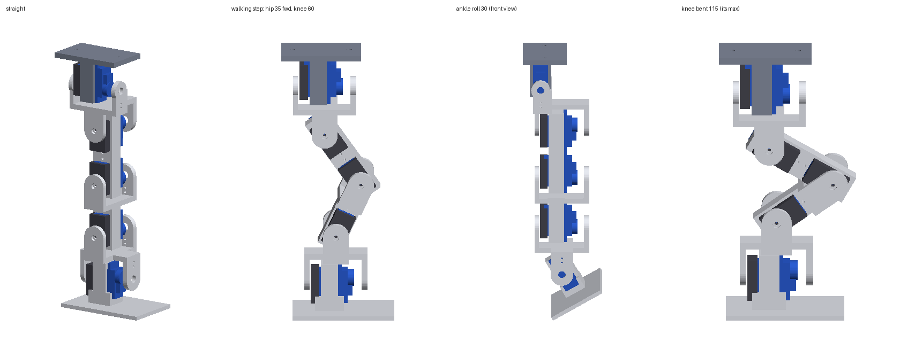

# Cheo biped leg v1 (5 servos)

## Print (PCTG, 3 walls, 15-20% infill, tree supports on)
| File | Per leg | Notes |
|---|---|---|
| `pelvis_test_mount` | 1 (only for testing one leg) | Holds the hip roll servo; clamp it to a table |
| `hip_yoke` | 1 | Supports needed |
| `thigh` | 1 | Prints flat, no supports |
| `shin` | 1 | Supports needed |
| `ankle_yoke` | 1 | Supports needed |
| `foot` | 1 | Prints flat |
| `shoe_2.0mm` | 5 | One slides onto the bottom of each servo (2.0 mm is the fit-tested size) |

## Fit test first
Print `stl/fit_test/fit_ring.stl` + `stl/fit_test/fit_bracket.stl` + a shoe to check one joint before printing a whole leg.

## Hardware
- 5x MG90S per leg, with the 3 screws that come in each bag and the single-arm horns
- Nothing else: no extra screws. Each joint uses only its servo's own 3 screws:
  - 2 long screws hold the servo's tabs in the ring
  - 1 short screw holds the horn on the servo's gear (through the big hole in the bracket)
  - the pivot is a printed 3 mm pin on the bracket that snaps into the hole in the shoe

## Assembly
1. Center every servo first: set it to 90° (knee: see below) **before** attaching anything.
2. Slide each servo into its ring from the outside, horn side out, and screw the tabs.
3. Slide a shoe onto the servo's bottom from the long end.
4. Press the single-arm horn into the bracket's triangle pocket, pointing toward the bridge (a drop of superglue is optional; the pocket alone stops it slipping).
5. Flex the bracket open a little, press the horn onto the servo's spline, and let the pivot pin click into the shoe's hole.
6. Put the short horn screw through the big hole in the bracket into the servo's gear.
7. Knee only: with the knee servo at 90°, attach the shin bent 45° backward (so the knee can bend 0-115°).

If a bracket is too tight or loose between the horn and the shoe, use the 2.5 or 3.0 mm shoe. If the pin won't click in, sand its tip; if it turns stiffly, twist the joint back and forth a few times to wear it in.

## Sizes
Hip roll axis to floor: 177 mm. Hip roll axes 20 mm apart, feet centered 52 mm apart (26 mm from the center line).
